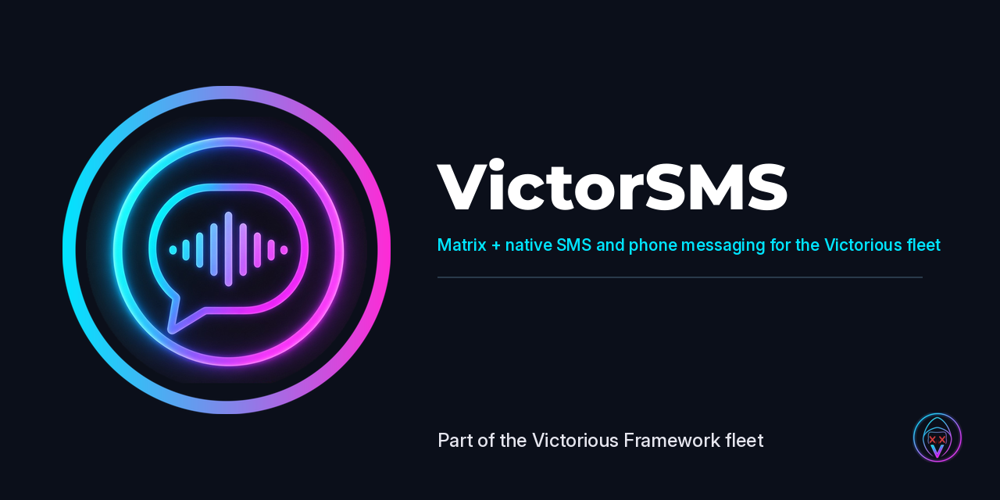

<div align="center">



# VictorSMS

**Matrix + native SMS/phone messaging for the Victorious fleet — dialer, spam blocking, Twilio alias, persona assist, and a DCA fleet bridge.**

Works on its own; fleet integration (droidcommand-AI) is optional

<p>
  <a href="https://github.com/Victorious93/victorsms/releases"></a>
  <a href="LICENSE"></a>
  <a href="https://github.com/Victorious93/victorsms/actions/workflows/android.yml"></a>
  <a href="https://victorious-framework.pages.dev"></a>
</p>

</div>

**Package id:** `com.victorious.sms` (standard edition). The voip edition uses `com.victorious.sms.voip` and can be installed beside it.

> **Testing status:** CI builds the standard debug APK and runs the unit tests (`mail-core`, `comms-core`, and the app). Nothing has been tested on a real device, or against a live Twilio account, a Matrix homeserver, or the PC AI stack. Features added after the `v0.2.0` tag are in `main` but **not** in the published APKs.

## Features

Everything optional stays **off by default**. Each item is described in the [manual](docs/MANUAL.md). Items below are in the code; none of them have been tried on a phone.

- **Native SMS and MMS**, plus a unified inbox.
- **Email** in that inbox (IMAP/SMTP, an outbox that protects against uncertain sends, and desktop drafts that wait for your review). Built in `main` after the `v0.2.0` tag — **not in the published APK**.
- **Matrix** multi-account client (Matrix Rust SDK). Needs a sliding-sync homeserver.
- **Conversation archive and Import Center** (import wizard, Update, Undo, share target; optional recording of new texts, off by default). Built in `main` after `v0.2.0` — **not in the published APK**. Tested on the JVM only.
- **Phone dialer** (`ROLE_DIALER`, in-call screen, call log) and **spam blocking** (call screening, blocklist, Spam folder).
- **Second number:** send texts and place calls from an owned Twilio alias, with a per-chat identity picker and an alias inbox. The app shows the price and waits for confirmation before any paid send, call, or number purchase. This is a real number you own, not a spoofed one. Twilio has not been tested live.
- **Alias calls** over the Twilio Voice SDK in the standard edition (the old SIP-calling stub was replaced).
- **Phone-to-phone relay** between two devices that both run the app (paired over mutual TLS, with on-device approval for remote sends and calls).
- **Persona drafter and voice notes**, behind a consent gate. The LLM and TTS run on a PC; a setup script is in [`pc/`](pc/README.md). That script has been statically checked but **has not been run on the real PC**.
- **In-app bots:** a summarizer/triage bot and a droidcommand-AI fleet command bot.
- **SMS remote-command trigger:** a sender whitelist and a code word forward a command to droidcommand-AI (`sms.remote_command.forward`). VictorSMS **forwards only; it never executes** remote commands.
- **Fleet bridge** (optional): pairing with other fleet apps, node status, config export/import, and remote SMS that still needs a tap on the phone. A read-only **assistant connector** can open archive conversations you switch on one by one (off by default); that landed after `v0.2.0` and has not been run against the real droidcommand-AI or on a device.
- **Fleet theme:** when VictorLaunch is installed and lists VictorSMS as a trusted app, the shared theme is applied live; otherwise the built-in neon theme is used.
- **Two editions** (see [docs/EDITIONS.md](docs/EDITIONS.md)): **standard** (Apache-2.0 sources, Twilio Voice SDK, no SIP engine) and **voip** (`com.victorious.sms.voip`, GPLv3 binary because it links Linphone, no Twilio Voice SDK). CI has an informational, non-blocking job that tries `assembleVoipDebug`. No voip APK is in the GitHub release. When the edition was added, it could not be built in that environment (`download.linphone.org` was blocked), and `LinphoneSipEngine` is still an uncompiled draft.

## Screenshots

No screenshots have been captured yet. Real ones will be added after testing on a device; none of the images in this repo are app screenshots.

## Install / download

**Debug-signed pre-release, not finished software.** It is signed with this repo's public debug key. Sideload only; not Play Store or production-signed. Install only if you understand the risk. The APKs attached to the release were not run on any device or emulator.

- Latest release: [v0.2.0](https://github.com/Victorious93/victorsms/releases/tag/v0.2.0) (pre-release, published 20 November 2026, built from commit [`957bee1`](https://github.com/Victorious93/victorsms/commit/957bee1cf230d0449b32d7b7545822504e58cda5))
- Per-ABI debug APKs (standard edition only):
  - [`app-arm64-v8a-debug.apk`](https://github.com/Victorious93/victorsms/releases/download/v0.2.0/app-arm64-v8a-debug.apk) — arm64-v8a, about 89 MB
  - [`app-armeabi-v7a-debug.apk`](https://github.com/Victorious93/victorsms/releases/download/v0.2.0/app-armeabi-v7a-debug.apk) — armeabi-v7a, about 64 MB
  - [`app-x86_64-debug.apk`](https://github.com/Victorious93/victorsms/releases/download/v0.2.0/app-x86_64-debug.apk) — x86_64, about 95 MB
- Checksums: [`SHA256SUMS`](https://github.com/Victorious93/victorsms/releases/download/v0.2.0/SHA256SUMS) — verify with `sha256sum -c SHA256SUMS`

> **This APK is older than the feature list above.** It does not include the email inbox, the two editions, the conversation archive / Import Center, the assistant connector, live archive recording, the fleet status-read fix, or the later outbox/archive/bridge crash fixes, all of which landed in pull requests #23–#29 after the tag.

An older pre-release, [v0.1.0-debug](https://github.com/Victorious93/victorsms/releases/tag/v0.1.0-debug), is still available with the same APK file names.

## Build from source

JDK 17. Kotlin + Jetpack Compose. minSdk 26, compileSdk 37, targetSdk 36.

```sh
./gradlew :mail-core:test :comms-core:test :app:testStandardDebugUnitTest
./gradlew assembleStandardDebug
```

That builds the **standard** edition (Apache-2.0 sources + Twilio Voice SDK; no SIP engine). ABI-split outputs land under `app/build/outputs/apk/standard/debug/`.

The **voip** edition (`assembleVoipDebug`, package `com.victorious.sms.voip`) links Linphone and is licensed GPLv3 as a binary. See [docs/EDITIONS.md](docs/EDITIONS.md). CI tries that assemble in a non-blocking job.

Debug builds use this repo's fixed debug keystore at `app/debug.keystore`. It is not a release key. Release keys are never committed; a release signing config is created only when the `VICTORSMS_RELEASE_*` environment variables are all set.

The PC-side persona and voice stack is a separate setup: see [pc/README.md](pc/README.md). The script has not been run on the real PC yet.

## Manual

How-to: [docs/MANUAL.md](docs/MANUAL.md)

Also: [docs/ARCHITECTURE.md](docs/ARCHITECTURE.md) · [docs/BRIDGES.md](docs/BRIDGES.md) · [docs/EDITIONS.md](docs/EDITIONS.md)

## License

The standard edition and this repository's own source files are Apache-2.0 — see [LICENSE](LICENSE).

The voip edition binary, if distributed, is GPLv3 because it links Linphone — see [LICENSE-GPL-3.0](LICENSE-GPL-3.0) and [docs/EDITIONS.md](docs/EDITIONS.md). That is an engineering split, not legal advice.
